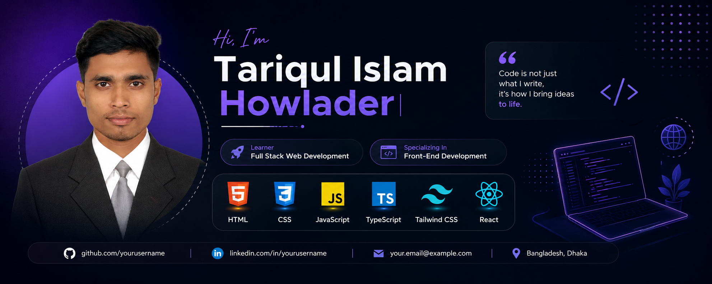

 

# Hi 👋, I'm Tariqul Islam Howlader

### Full-Stack Web Development | Front-End Developer

Building modern, responsive, and user-friendly web applications.

📍 Barishal, Bangladesh

📧 Email: hmtarek004@gmail.com

---

## 👨‍💻 About Me

I'm Tariqul Islam Howlader, an aspiring Full-Stack Web Developer from Bangladesh. I'm passionate about building modern, responsive, and user-friendly web applications using modern web technologies.

- 🌱 Currently exploring **Full-Stack Web Development**
- ⚛️ Building web applications with **Next.js, React, and TypeScript**
- 🎨 Creating responsive user interfaces with **Tailwind CSS**
- 🛒 Building **BazarDor BD**, a Bangladeshi market-price website
- 🏋️ Developing **FitLog Workout Planner**, a fitness and workout-planning application
- 🔌 Exploring **REST APIs, Node.js, and Express.js**
- 🗄️ Learning database integration with **MongoDB**
- 🔐 Exploring authentication and user management with **Better Auth**
- 🎯 My goal is to become a professional **Full-Stack Web Developer**

## 🛠️ Skills & Technologies

### Languages

  

### Front-End Development

  

### Tools & Technologies

  

### Currently Exploring

  

---

## 🚀 Featured Projects

<table>
<tr>
<td width="50%" valign="top">

### 🛒 BazarDor BD

A Bengali-language web application for exploring everyday product prices and price changes in Bangladesh.

**Tech Stack**

`Next.js` `React` `TypeScript` `Tailwind CSS` `MongoDB` `Better Auth` `HeroUI`

**Highlights**

- Product price information
- Category-based browsing
- Daily price-change indicators
- Responsive user interface

[🌐 Live Demo](https://bazar-dor-bd-app-two.vercel.app/)

[📂 Source Code](https://github.com/hm-fullstackdeveloper/bazar-dor-bd-app-A7)

</td>
<td width="50%" valign="top">

### 🏋️ FitLog Workout Planner

A workout-planning application designed to help users explore workouts and organize personal fitness plans.

**Tech Stack**

`Next.js` `React` `TypeScript` `Tailwind CSS` `daisyUI`

**Highlights**

- Workout browsing and details
- Personal workout planning
- Saved and completed workouts
- Responsive interface

[🌐 Live Demo](https://fitlog-workout-planner-next-js-app-two.vercel.app/)

[📂 Source Code](https://github.com/hm-fullstackdeveloper/fitlog-workout-planner-next.js-app-A6)

</td>
</tr>
</table>

---

## 📊 GitHub Statistics

 

## 📈 Contribution Activity

---

## 🤝 Let's Connect

I'm always interested in learning, building projects, and connecting with other developers.

- 💻 GitHub: [@hm-fullstackdeveloper](https://github.com/hm-fullstackdeveloper)
- 💼 LinkedIn:[Linkedin](https://www.linkedin.com/in/tariqulislamhawlader)
- 📧 Email: [hmtarek004@gmail.com](https://hmtarek004@gmail.com)

### 🌱 Learn. Build. Improve. Repeat.

*Every project is an opportunity to learn something new.*

